# NAI ACLAB 처음 사용 가이드

NAI ACLAB은 NovelAI 이미지 생성에서 **작가 태그 조합**을 실험하고, 그중 가장 마음에 드는 그림체를 찾도록 돕는 Windows 앱입니다.
이 문서는 처음 쓰는 분이 설치부터 "나만의 최적 조합"을 찾을 때까지 순서대로 따라 할 수 있게 정리했습니다.

> 처음에는 **체험 모드**로 켜져 있어 NovelAI에 접속하지 않고 그라데이션 테스트 이미지를 만듭니다. Anlas가 소모되지 않으니, 실제로 돌리기 전에 체험 모드로 한 바퀴 익혀 보세요.

## 목차

1. [설치와 첫 실행](#1-설치와-첫-실행)
2. [화면 구성](#2-화면-구성)
3. [기본 준비: 프롬프트와 작가 그룹](#3-기본-준비-프롬프트와-작가-그룹)
4. [이미지 만들고 비교하기 (작업실)](#4-이미지-만들고-비교하기-작업실)
5. [여러 장면에서 시험하기 (타율 테스트)](#5-여러-장면에서-시험하기-타율-테스트)
6. [최적의 그림체 찾기 (탐색)](#6-최적의-그림체-찾기-탐색)
7. [실제 생성으로 전환하기](#7-실제-생성으로-전환하기)
8. [단축키 모음](#8-단축키-모음)
9. [자주 묻는 질문](#9-자주-묻는-질문)

---

## 1. 설치와 첫 실행

1. 설치 파일(`NAI-ACLAB-…-setup.exe`)을 더블클릭합니다.
   - "Windows의 PC 보호" 창이 뜨면 **추가 정보 → 실행**을 누릅니다.
   - WebView2가 없는 PC에서는 설치 프로그램이 자동으로 내려받습니다. Python이나 Node.js는 필요 없습니다.
2. 설치가 끝나면 시작 메뉴에서 **NAI ACLAB**을 실행합니다.
3. 하단 오른쪽에 **체험 모드**라고 표시되면 준비 완료입니다.

모든 데이터는 `%USERPROFILE%\nai_aclab` 폴더에 저장됩니다.

| 폴더 | 내용 |
| --- | --- |
| `data\` | 설정, 프리셋, 작가 목록, 생성 기록 |
| `outputs\` | 생성한 이미지 (작업마다 하위 폴더) |
| `explore\` | 탐색 캠페인 기록 (선택·라벨·성공률) |

## 2. 화면 구성

상단 메뉴는 7개입니다. 처음에는 **프롬프트 → 작가 → 작업실** 순서로 둘러보면 됩니다.

| 메뉴 | 하는 일 |
| --- | --- |
| **작업실** | 이미지를 만들고, 크게 보고, 두 장을 비교합니다. |
| **프롬프트** | 장면·캐릭터 프롬프트를 프리셋으로 저장합니다. |
| **작가** | 작가 태그를 그룹별로 등록하고 가중치 범위를 정합니다. |
| **타율 테스트** | 한 조합을 여러 장면(프리셋)에서 시험합니다. |
| **가이던스 테스트** | 한 이미지의 Guidance·Rescale 값을 격자로 비교합니다. |
| **탐색** | 그룹을 하나씩 바꿔 가며 최적의 조합을 찾습니다. |
| **설정** | API 토큰, 모델, 크기, 체험 모드를 설정합니다. |

화면 아래 상태줄에는 생성 진행률과 대기열이 표시됩니다. 변경 사항은 입력을 멈추면 자동 저장되고, 오른쪽 위에 "자동 저장됨"이 표시됩니다.

## 3. 기본 준비: 프롬프트와 작가 그룹

### 프롬프트 프리셋 만들기

**프롬프트** 메뉴에서 공통 설정(퀄리티·공통 네거티브)과 개별 프리셋을 정합니다.

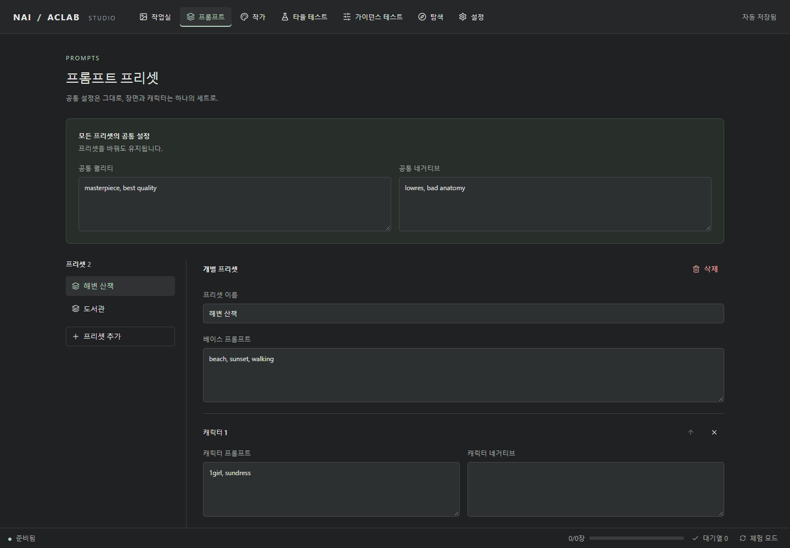

- **공통 설정**은 모든 프리셋에 공통으로 붙습니다.
- **개별 프리셋**은 "장면 하나"라고 생각하면 됩니다. 예: `기본`(상반신), `전신 서기`, `앉은 자세`.
- 최종 프롬프트 순서: `베이스, 작가 태그, 퀄리티 | 캐릭터 1 | 캐릭터 2 …`

> 탐색과 타율 테스트는 프리셋을 "장면"으로 씁니다. 자세·구도가 서로 다른 프리셋을 2~4개 만들어 두면 좋습니다.

### 작가 그룹 등록하기

**작가** 메뉴에서 작가 태그를 **그룹**으로 나눠 등록합니다. 그룹 이름과 개수는 자유입니다.

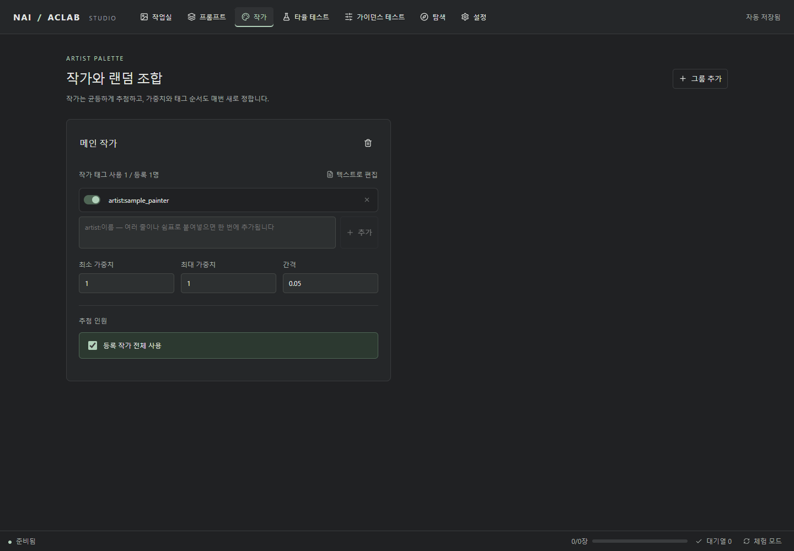

예시 구성:

| 그룹 | 역할 | 가중치 범위 예 | 추첨 인원 예 |
| --- | --- | --- | --- |
| 메인 | 그림체의 중심 | 1.0 ~ 1.4 | 2~3명 |
| 색감 | 채색·톤 | 0.5 ~ 1.0 | 1~2명 |
| 신체 | 인체 안정성 | 0.4 ~ 0.9 | 1~2명 |
| 배경 | 배경 표현 | 0.5 ~ 0.9 | 1명 |

- 태그는 `artist:이름` 형식으로 한 줄에 하나씩 붙여 넣습니다. 가중치(`1.2::`)가 붙어 있어도 자동으로 정리됩니다.
- 행 왼쪽 스위치로 작가를 잠시 빼 둘 수 있습니다(삭제하지 않고 추첨에서만 제외).
- **간격**은 가중치 후보의 단위입니다. 0.05면 1.00, 1.05, 1.10…처럼 고릅니다.
- 그룹 순서가 곧 프롬프트 안의 작가 태그 순서입니다(위쪽 그룹이 앞).

## 4. 이미지 만들고 비교하기 (작업실)

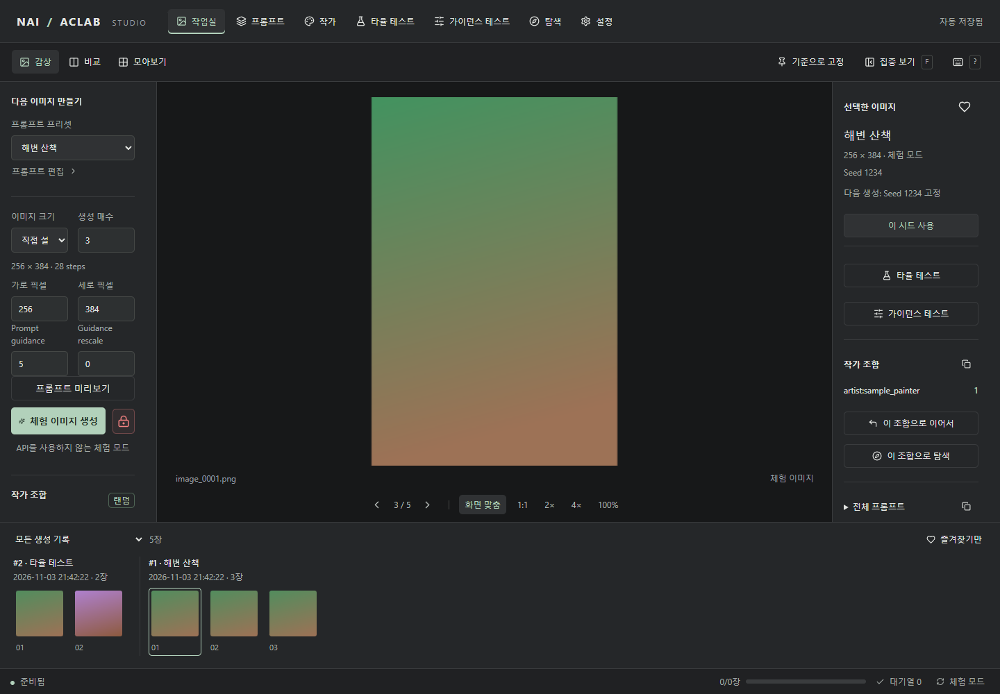

1. 왼쪽에서 **프리셋**, **이미지 크기**, **생성 매수**를 고릅니다.
2. **체험 이미지 생성**(실제 모드에서는 생성 버튼)을 누릅니다. 작가 그룹마다 무작위로 작가와 가중치가 뽑힙니다.
3. 아래 필름 스트립에서 결과를 고르고, 오른쪽 패널에서 작가 조합·프롬프트·시드를 확인합니다.

마음에 드는 이미지가 나오면 오른쪽 패널에서:

- **이 조합으로 이어서**: 작가·가중치·순서를 고정해 다음 생성에 그대로 씁니다.
- **이 조합으로 탐색**: 이 이미지를 출발점으로 [탐색](#6-최적의-그림체-찾기-탐색)을 시작합니다.
- **기준으로 고정**: 이 이미지를 고정해 두고 다른 결과와 나란히 비교합니다.

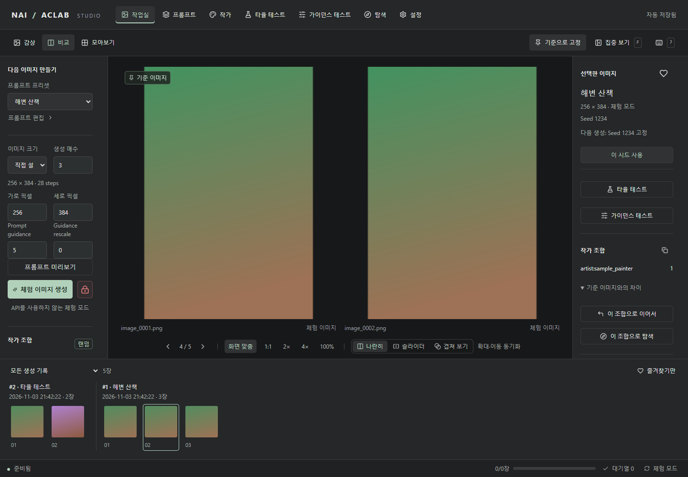

## 5. 여러 장면에서 시험하기 (타율 테스트)

한 장만 잘 나온 조합은 다른 자세에서 무너질 수 있습니다. **타율 테스트**는 같은 조합을 여러 프리셋으로 생성해 안정성을 봅니다.

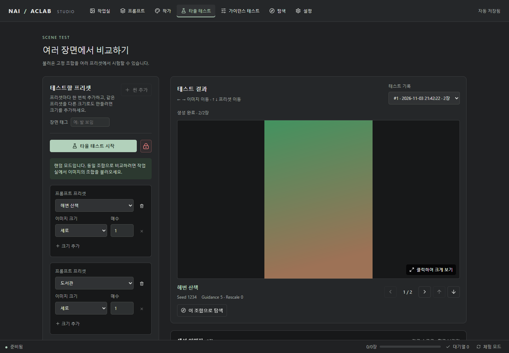

1. **씬 추가**로 시험할 프리셋을 추가하고, 이미지 크기와 매수를 정합니다.
   - 프리셋은 한 번씩만 추가할 수 있습니다. 이미 추가된 프리셋은 목록에 "(추가됨)"으로 표시됩니다.
   - 같은 프리셋을 다른 크기로도 만들고 싶으면, 그 프리셋 카드 안의 **+ 크기 추가**를 누릅니다. 세로·가로·정사각형을 각각 한 줄씩 넣을 수 있고, 줄마다 매수를 따로 정합니다.
   - 탐색의 타율 검증과 최종 확인은 각 프리셋의 **첫 번째 크기**로 생성합니다.
2. 필요하면 **장면 태그**를 씁니다. 기본 태그는 없습니다.
   - **테스트할 프리셋** 제목 아래 **장면 태그** 칸에 이름을 입력하고 Enter를 눌러 태그를 만듭니다.
   - 각 장면 아래에 만든 태그가 버튼으로 나옵니다. 눌러서 켜고 끕니다(점선 = 꺼짐, 채워짐 = 켜짐).
   - 위 목록에서 태그를 지우면 모든 장면에서도 빠집니다.
   - 예: 발이 보이는 장면에만 `발 보임` 태그를 켜 두면, 탐색에서 발 그룹의 검증 장면을 그 태그로 제한할 수 있습니다.
3. 작업실에서 조합을 고정한 뒤 **타율 테스트 시작**을 누릅니다.

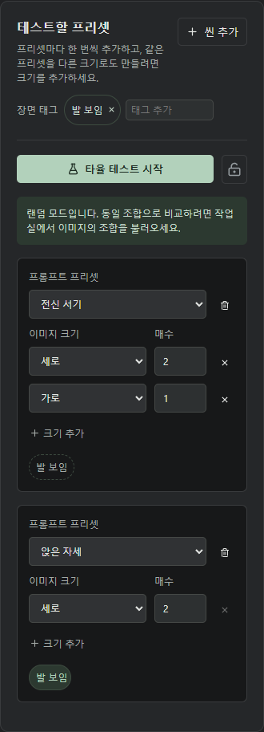

## 6. 최적의 그림체 찾기 (탐색)

탐색은 이 앱의 핵심 기능입니다. 원칙은 세 가지입니다.

- **화풍은 사람이 고른다**: 점수를 매기지 않고, 같은 시드로 나란히 놓고 마음에 드는 것을 고릅니다.
- **안정성은 비율로 잰다**: 실패한 이미지만 표시하고, 나머지는 성공으로 셉니다.
- **한 번에 한 그룹만 바꾼다**: 결과가 바뀐 이유를 알 수 있게, 나머지 그룹은 고정합니다.

하나의 탐색을 **캠페인**이라고 부릅니다. 캠페인은 자동 저장되며, 앱을 닫았다가 다시 열어도 이어서 진행할 수 있습니다.

### 6-1. 캠페인 만들기

**탐색 → 새 캠페인**을 누릅니다. 작업실에서 **이 조합으로 탐색**을 눌러 들어오면 그 이미지의 작가가 미리 채워집니다.

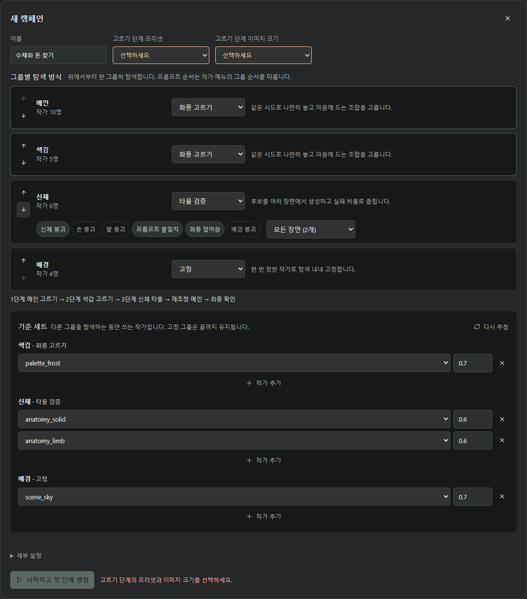

1. **이름**을 정하고, **고르기 단계 프리셋**(화풍을 고를 때 쓸 장면)과 **고르기 단계 이미지 크기**(세로·가로·정사각형)를 고릅니다.
   - 두 칸은 처음에 "선택하세요"로 비어 있고 주황색으로 표시됩니다. 둘 다 고르기 전에는 시작 버튼이 눌리지 않습니다. 의도하지 않은 장면이나 크기로 생성이 시작되는 것을 막기 위해서입니다.
   - 고른 크기는 화풍 고르기 단계와 재조정 단계에 쓰입니다. 작업실의 크기 설정과는 별개입니다.
   - 화풍 고르기 그룹이 하나도 없으면 두 칸은 나타나지 않습니다.
2. **그룹별 탐색 방식**에서 그룹마다 방식을 고릅니다. 그룹 이름을 보고 자동으로 추천해 주지만, 자유롭게 바꿀 수 있습니다.

   | 방식 | 언제 쓰나요? | 하는 일 |
   | --- | --- | --- |
   | **화풍 고르기** | 메인, 색감처럼 "보기 좋은지"가 중요한 그룹 | 6개 조합을 나란히 보고 마음에 드는 것을 고릅니다. |
   | **타율 검증** | 신체, 손, 발처럼 "무너지지 않는지"가 중요한 그룹 | 후보 8개를 여러 장면에서 생성하고, 실패 비율로 좁힙니다. |
   | **고정** | 배경처럼 이번에는 건드리지 않을 그룹 | 처음 정한 작가를 끝까지 씁니다. |
   | **사용 안 함** | 이번 탐색에서 빼고 싶은 그룹 | 프롬프트에 넣지 않습니다. |

3. ↑↓ 버튼으로 **탐색 순서**를 정합니다. 보통 화풍 그룹을 먼저, 안정성 그룹을 나중에 둡니다. 아래 줄에 실제 진행 순서가 미리 보입니다.
   예: `1단계 메인 고르기 → 2단계 색감 고르기 → 3단계 신체 타율 → 재조정 메인 → 최종 확인`
4. **타율 검증** 그룹은 실패 라벨(신체·손·발 붕괴, 프롬프트 불일치, 화풍 덮어씀, 배경 붕괴)과 검증할 장면을 고릅니다. 장면이 2개 미만이면 빨간 안내가 나옵니다.
5. **기준 세트**는 다른 그룹을 탐색하는 동안 쓰는 작가입니다. 추첨된 값을 확인하고, 원하면 직접 고치거나 **다시 추첨**합니다.
6. 필요하면 **세부 설정**을 열어 생성 장수를 조절합니다. 처음에는 기본값 그대로 두어도 됩니다([아래 설명](#세부-설정)).
7. **시작하고 첫 단계 생성**을 누릅니다.

> 프롬프트 안의 그룹 순서는 탐색 순서와 상관없이 항상 **작가 메뉴의 그룹 순서**를 따릅니다.

### 세부 설정

**세부 설정**은 "얼마나 많이 생성해서 얼마나 확실하게 고를지"를 정합니다. 값을 키우면 결과를 더 믿을 수 있지만 생성 장수(=시간, 실제 모드에서는 Anlas)가 늘어납니다.
세부 설정을 열면 각 칸 아래에 짧은 설명이, 맨 아래에 **현재 값으로 생성될 장수**가 단계별로 표시되니 시작하기 전에 확인하세요.

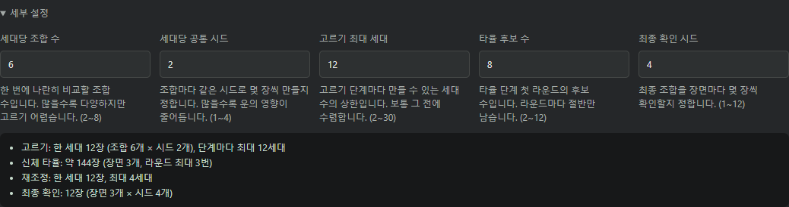

| 항목 | 기본값 | 범위 | 쓰이는 단계 | 의미 |
| --- | --- | --- | --- | --- |
| 세대당 조합 수 | 6 | 2~8 | 화풍 고르기, 재조정 | 한 세대에 나란히 놓고 비교할 조합(열) 수 |
| 세대당 공통 시드 | 2 | 1~4 | 화풍 고르기, 재조정 | 조합마다 같은 시드로 만들 장수(행 수) |
| 고르기 최대 세대 | 12 | 2~30 | 화풍 고르기 | 고르기 단계 하나에서 만들 수 있는 세대 수의 상한 |
| 타율 후보 수 | 8 | 2~12 | 타율 검증 | 첫 라운드에서 겨룰 후보 수 |
| 최종 확인 시드 | 4 | 1~12 | 최종 확인 | 최종 조합을 장면마다 몇 장씩 확인할지 |

**세대당 조합 수**
- 한 세대 장수 = 조합 수 × 공통 시드 수입니다(기본 6 × 2 = 12장).
- 화면에서 한눈에 비교할 수 있는 만큼이 적당합니다. 모니터가 작으면 4, 크면 8도 괜찮습니다.
- 6보다 작으면 다음 세대의 "랜덤"·"변이" 자리부터 줄어들어 새로운 시도가 적어지고, 6보다 크면 늘어난 자리는 1등 조합의 변이로 채워집니다.

**세대당 공통 시드**
- 같은 줄(행)은 시드가 같아서, 줄 안의 차이는 오직 작가 조합 때문입니다. 시드를 2개 이상 쓰면 "이 시드에서만 우연히 잘 나온 조합"을 걸러낼 수 있습니다.
- 1로 줄이면 빠르지만 운의 영향이 커집니다. **2 이상을 권장**합니다.

**고르기 최대 세대**
- 보통은 같은 1등이 3세대 연속 나오면서 그 전에 끝납니다. 이 값은 끝없이 이어지지 않게 하는 안전장치입니다.
- 상한에 도달하면 새 세대를 만들지 않고 단계 완료 버튼으로 우승 조합을 확정하라고 안내합니다.
- 화풍 고르기 그룹이 여러 개면 단계마다 각각 적용됩니다. 재조정은 이 값과 상관없이 최대 4세대입니다.

**타율 후보 수**
- 첫 라운드 후보는 **기준 세트 1개 + 기준 세트의 변이 + 새로 뽑은 조합**으로 채웁니다(8이면 1 + 3 + 4).
- 라운드마다 성공률 상위 절반만 남고, 장면당 시드는 2 → 4 → 8로 늘어납니다. 후보가 적으면 라운드가 일찍 끝납니다(2~3이면 첫 라운드 뒤 바로 결승).
- 타율 단계 장수(장면 K개 기준): 후보 8이면 `8×K×2 + 4×K×4 + 2×K×8 = 48×K`장입니다. 장면 3개면 144장, 4개면 192장입니다.
- 작가 수가 적은 그룹은 서로 다른 후보를 충분히 만들 수 없어 실제 후보가 이보다 적을 수 있습니다.

**최종 확인 시드**
- 최종 확인 장수 = 전체 장면 수 × 이 값입니다(장면 4개, 기본 4면 16장).
- 장수가 많을수록 최종 성공률의 신뢰구간(괄호 안 범위)이 좁아져 더 믿을 수 있는 숫자가 됩니다.

**상황별 추천 값**

| 상황 | 조합 수 | 공통 시드 | 최대 세대 | 타율 후보 | 확인 시드 | 한 세대 | 타율 단계 (장면 3개) |
| --- | --- | --- | --- | --- | --- | --- | --- |
| 빠르게 맛보기 | 4 | 2 | 6 | 4 | 2 | 8장 | 48장 |
| 표준 (기본값) | 6 | 2 | 12 | 8 | 4 | 12장 | 144장 |
| 꼼꼼하게 | 6 | 3 | 20 | 12 | 8 | 18장 | 216장 |

> 처음에는 체험 모드에서 **빠르게 맛보기** 값으로 흐름을 익히고, 실제 생성에서는 **표준**으로 시작하는 것을 권장합니다.

세부 설정에 없는 값은 고정입니다: 수렴 모드는 같은 1등 2세대 연속, 단계 완료 제안은 3세대 연속, 타율 라운드의 장면당 시드는 2 → 4 → 8, 재조정은 최대 4세대, 성공률 구간은 90%입니다.

### 6-2. 화풍 고르기 단계

조합 6개 × 같은 시드 2개 = 12장이 나란히 생성됩니다. 같은 줄은 시드가 같으니, 차이는 오직 작가 조합 때문입니다.

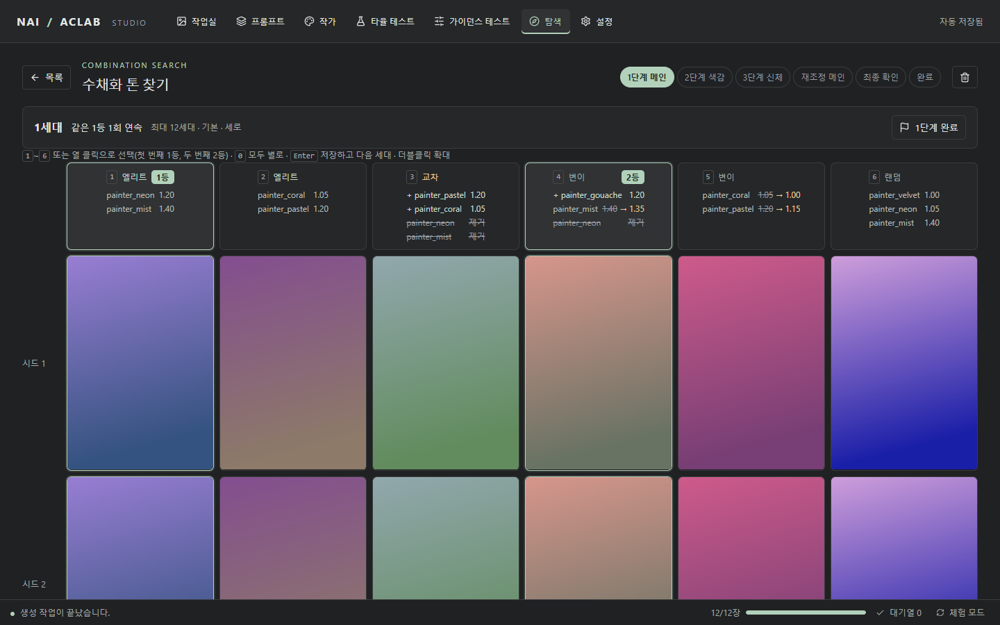

1. 마음에 드는 열을 클릭하거나 숫자키 **1~6**을 누릅니다. 첫 번째는 **1등**, 두 번째는 **2등**입니다. 다시 누르면 해제됩니다.
2. 전부 별로라면 **0**을 누릅니다.
3. **Enter**를 누르면 선택이 저장되고 다음 세대가 생성됩니다.
4. 이미지를 **더블클릭**하면 크게 볼 수 있습니다. ← → 는 다른 조합, ↑ ↓ 는 다른 시드입니다.

열 머리에는 그 조합이 어떻게 만들어졌는지 표시됩니다.

| 표시 | 의미 |
| --- | --- |
| 엘리트 | 지난 세대에 고른 조합(새 시드로 다시 확인) |
| 교차 | 1등과 2등을 섞은 조합 |
| 변이 | 고른 조합에서 조금 바꾼 조합 |
| 랜덤 | 새로 뽑은 조합 |

바뀐 부분은 색으로 강조됩니다. `1.25 → 1.30`은 가중치 변경, `+ 이름`은 추가된 작가, 취소선은 빠진 작가입니다. 무엇을 바꾸면 좋아지는지 자연스럽게 감이 잡힙니다.

- 같은 조합이 2세대 연속 1등이면 **수렴 모드**가 켜져 가중치를 미세하게만 조정합니다.
- 3세대 연속 1등이면 **N단계 완료** 버튼이 강조됩니다. 눌러서 우승 조합을 확정하고 다음 단계로 넘어갑니다.
- 한 번이라도 고른 조합은 **보관함**에 남아 언제든 다시 넣을 수 있습니다.

### 6-3. 타율 검증 단계

후보 8개를 장면 × 시드로 생성하고, **실패한 이미지만 표시**합니다. 표시하지 않은 이미지는 성공으로 칩니다.

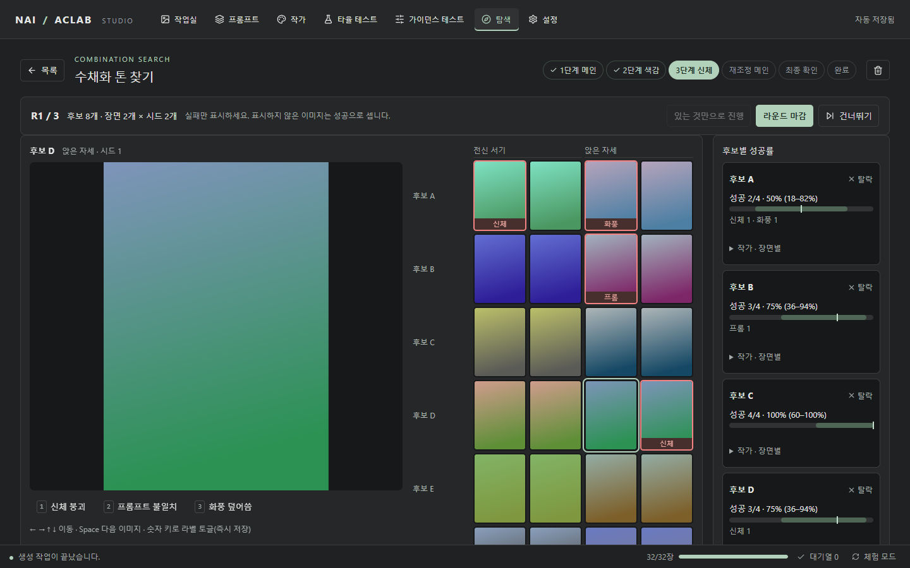

1. 화살표 키로 이미지를 옮겨 다니고, **Space**로 다음 이미지로 넘어갑니다.
2. 실패한 이미지에서 숫자키(1, 2, 3…)로 라벨을 붙입니다. 버튼 옆에 번호가 표시되며, 즉시 저장됩니다.
3. "화풍 덮어씀"은 앞 단계에서 고른 그림체가 뭉개지거나 바뀐 경우에 붙입니다.
4. 오른쪽에서 후보별 `성공 22/28 · 79% (64–88%)`와 구간 막대를 볼 수 있습니다. 괄호 안은 90% 신뢰구간으로, 막대가 짧을수록 결과를 믿을 만합니다.
5. 다 봤으면 **라운드 마감**을 누릅니다. 성공률 상위 절반이 남고, 다음 라운드는 시드가 두 배가 됩니다(8 → 4 → 2).
6. 마지막 라운드가 끝나면 우승 후보를 고릅니다. 두 후보의 구간이 겹치면 "통계적으로 구분되지 않음"이라고 알려 주니, 취향대로 고르면 됩니다.

> 후보 옆 **탈락**·**되살리기**로 직접 조정할 수도 있습니다. 생성이 덜 끝났어도 **있는 것만으로 진행**으로 넘어갈 수 있습니다.

### 6-4. 재조정과 최종 확인

- **재조정**: 안정화 그룹이 바뀌면 메인 그룹의 최적 가중치도 조금 달라집니다. 수렴 모드로 몇 세대만 다시 고릅니다. 바꿀 필요가 없으면 "기존 조합 그대로 두기"를 고르면 됩니다.
- **최종 확인**: 최종 조합을 모든 장면에서 생성하고 실패만 표시한 뒤 **확인 완료**를 누릅니다.

### 6-5. 결과 활용하기

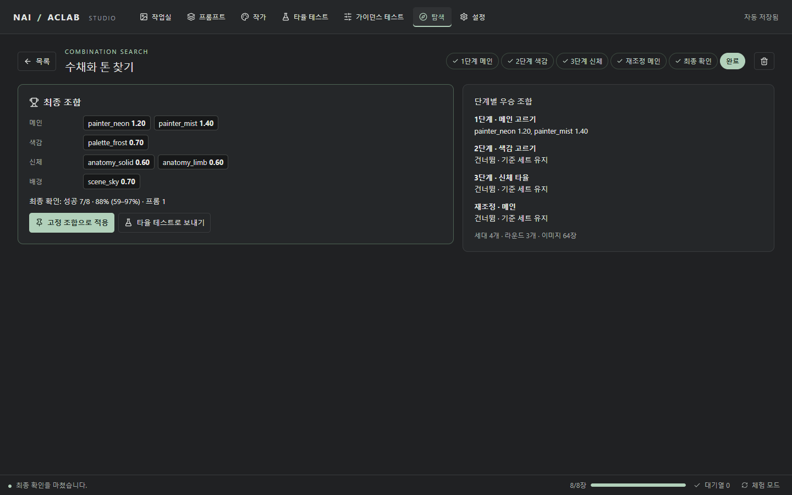

- **고정 조합으로 적용**: 작업실의 다음 생성에 최종 조합을 그대로 씁니다.
- **타율 테스트로 보내기**: 최종 조합을 고정하고 타율 테스트 메뉴로 이동합니다.
- 오른쪽에는 단계별 우승 조합이 요약됩니다.

### 탐색 팁

- 어느 단계든 **건너뛰기**로 넘어갈 수 있습니다. 건너뛴 그룹은 기준 세트를 그대로 씁니다.
- 생성 중 앱을 닫아도, 다시 열고 생성 버튼을 누르면 **빠진 이미지만** 만듭니다.
- 한 세대는 12장, 타율 단계는 장면 4개 기준 약 190장입니다. 처음에는 장면 2~3개로 시작해 보세요. 생성 장수는 **세부 설정**에서 줄일 수 있습니다.
- 생성된 탐색 이미지는 작업실 기록에도 남아 그곳에서 다시 볼 수 있습니다.

## 7. 실제 생성으로 전환하기

1. **설정** 메뉴를 엽니다.
2. NovelAI 계정의 **API 토큰**을 입력합니다. 토큰은 Windows 계정에 암호화되어 저장됩니다.
3. **API 없이 체험하기**를 끕니다.
4. 하단 상태줄에서 남은 Anlas를 확인할 수 있습니다.

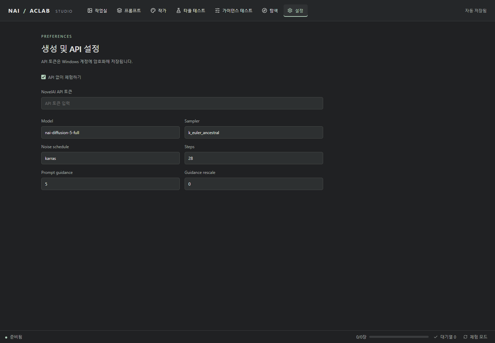

> 실제 모드에서는 생성할 때마다 Anlas가 소모될 수 있습니다. 탐색처럼 장수가 많은 기능은 생성 버튼에 표시된 장수(`48장 생성` 등)를 확인하고 누르세요.

## 8. 단축키 모음

| 위치 | 키 | 동작 |
| --- | --- | --- |
| 작업실 | ← → | 이전 · 다음 이미지 |
| 작업실 | 1 / 2 / 3 | 감상 / 비교 / 모아보기 |
| 작업실 | P | 현재 이미지를 비교 기준으로 고정 |
| 작업실 | F / Esc | 집중 보기 / 해제 |
| 작업실 | H | 즐겨찾기 |
| 작업실 | Ctrl + Enter | 생성 대기열에 추가 |
| 작업실 | ? | 단축키 안내 열기 · 닫기 |
| 확대 화면 | 마우스 휠 · 더블클릭 | 확대 · 축소 / 1:1 ↔ 화면 맞춤 |
| 탐색 – 화풍 고르기 | 1~6 | 조합 선택 · 해제 (1등 → 2등 순) |
| 탐색 – 화풍 고르기 | 0 | 모두 별로 |
| 탐색 – 화풍 고르기 | Enter | 선택 저장 · 다음 세대 생성 |
| 탐색 – 확대 화면 | ← → / ↑ ↓ | 다른 조합 / 다른 시드 |
| 탐색 – 타율 검증 | 화살표 | 이미지 이동 |
| 탐색 – 타율 검증 | Space | 다음 이미지 |
| 탐색 – 타율 검증 | 1~6 | 실패 라벨 토글 (그룹마다 번호가 다름) |

## 9. 자주 묻는 질문

**Q. 체험 모드 이미지는 왜 그라데이션인가요?**
A. 체험 모드는 NovelAI에 요청하지 않고 테스트 이미지를 만듭니다. 기능을 익히는 용도이며, 실제 그림은 [실제 생성으로 전환](#7-실제-생성으로-전환하기)한 뒤 나옵니다.

**Q. 작가 그룹 이름이 메인/신체/발이 아니어도 탐색을 쓸 수 있나요?**
A. 네. 그룹 이름과 개수는 자유이고, 캠페인을 만들 때 그룹마다 방식(고르기·타율·고정·사용 안 함)을 직접 고릅니다.

**Q. "검증할 장면이 부족합니다"라는 창이 떠요.**
A. 다음 타율 단계에 쓸 장면이 2개 미만입니다. **타율 테스트** 메뉴에서 장면(프리셋)을 추가하거나 태그를 붙이세요. 장면이 하나도 없으면 그 단계를 건너뛰고 진행할 수 있습니다.

**Q. 탐색을 중간에 멈추면 기록이 사라지나요?**
A. 아니요. 선택과 라벨은 누를 때마다 저장됩니다. 목록에서 캠페인을 다시 열면 이어서 진행할 수 있습니다.

**Q. 캠페인을 삭제하면 이미지도 지워지나요?**
A. 아니요. 선택·라벨 기록만 지워지고, 이미지 파일과 작업실 기록은 그대로 남습니다.

**Q. 생성이 실패(오류)한 이미지는 어떻게 되나요?**
A. API 오류는 "실패"로 세지 않고 무효 처리됩니다. 다시 생성 버튼을 누르면 그 칸만 다시 만듭니다.
